# Banco de Dados com SQL

Trilha de estudo baseada nos 12 módulos do ENIAC. Os exercícios são originais e usam uma loja fictícia.

## Como praticar

Execute [laboratorio.sql](laboratorio.sql) no MySQL Workbench em um servidor de treino, usando um esquema `study_sql` novo. Para comparar com o gabarito, comece cada módulo na base inicial. Nos exercícios de escrita, use transações quando aplicável ou uma cópia descartável. DDL no MySQL pode confirmar transações implicitamente.

## 1. Conceitos de banco de dados

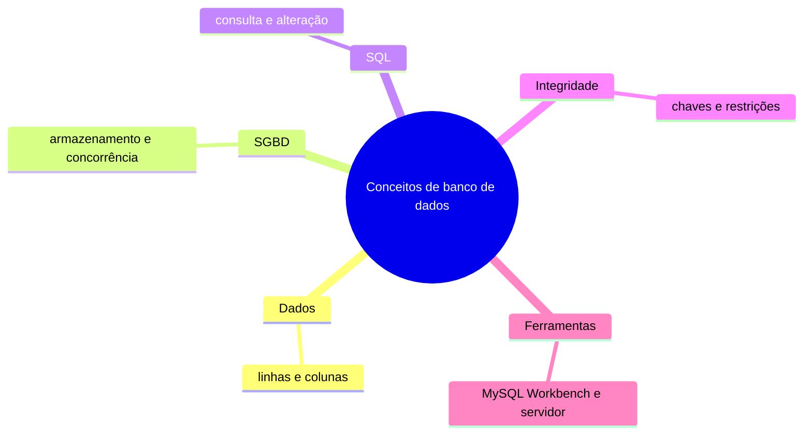

### Prática

1. No Workbench, conecte-se ao servidor e identifique qual é o cliente, qual é o SGBD e onde o esquema aparece.
2. Liste os clientes ativos, retornando somente nome e e-mail.
3. Escreva por que duas pessoas editando o mesmo estoque exigem controles que uma planilha simples não oferece.

## 2. Evolução dos bancos de dados

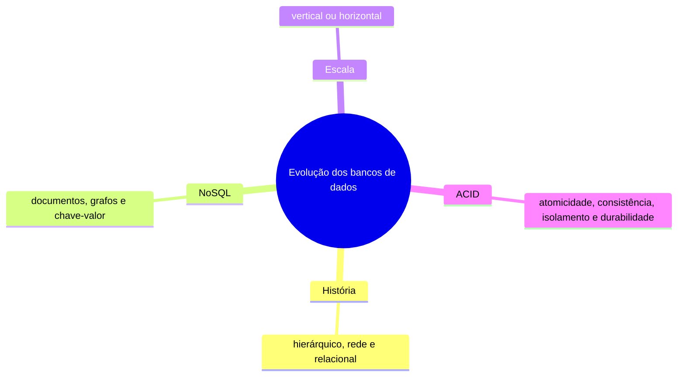

### Prática

1. Represente em JSON dois produtos com atributos diferentes e compare com uma tabela relacional.
2. Escolha um modelo para pedidos financeiros e outro para um catálogo de atributos variáveis. Justifique.
3. Simule uma transferência de 10 unidades entre produtos 1 e 2 usando duas atualizações e ROLLBACK.

## 3. Modelo relacional

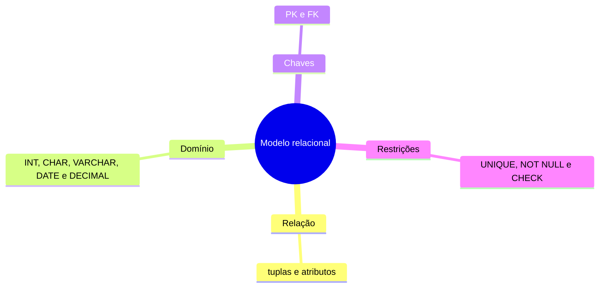

### Prática

1. Proponha tipos para CPF, UF, data de nascimento e preço. Preserve zeros à esquerda.
2. Tente inserir um pedido para o cliente 999 em uma base de treino e identifique a restrição que o impede.
3. Inspecione a PK de item_pedido. Explique por que um produto pode aparecer em pedidos diferentes.

## 4. Diagrama entidade-relacionamento

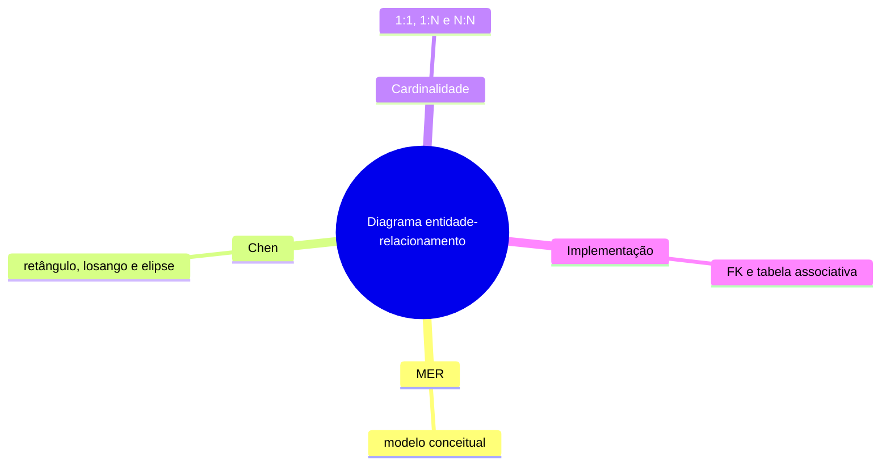

### Prática

1. Desenhe o DER de cliente, pedido e produto na notação de Chen.
2. Inclua as cardinalidades mínimas e máximas. Um cliente pode existir sem pedidos?
3. Transforme o relacionamento entre pedido e produto em tabelas. Inclua quantidade e preço praticado.

## 5. Normalização de dados

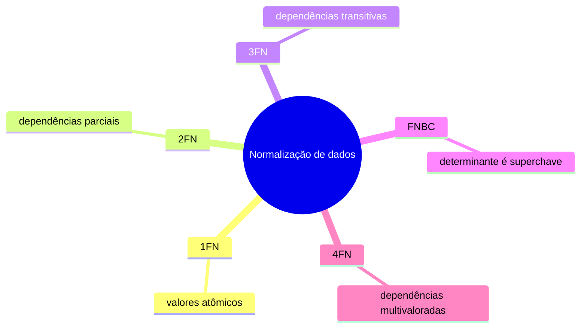

### Prática

1. Decomponha uma ficha que armazena vários telefones separados por vírgula.
2. Normalize a relação Venda(pedido_id, produto_id, cliente_id, nome_cliente, nome_produto, quantidade) até 3FN, assumindo chave composta e um cliente por pedido.
3. Um fornecedor tem contatos e categorias independentes. Explique como evitar a multiplicação artificial de linhas e relacione à 4FN.

## 6. Linguagem SQL básica

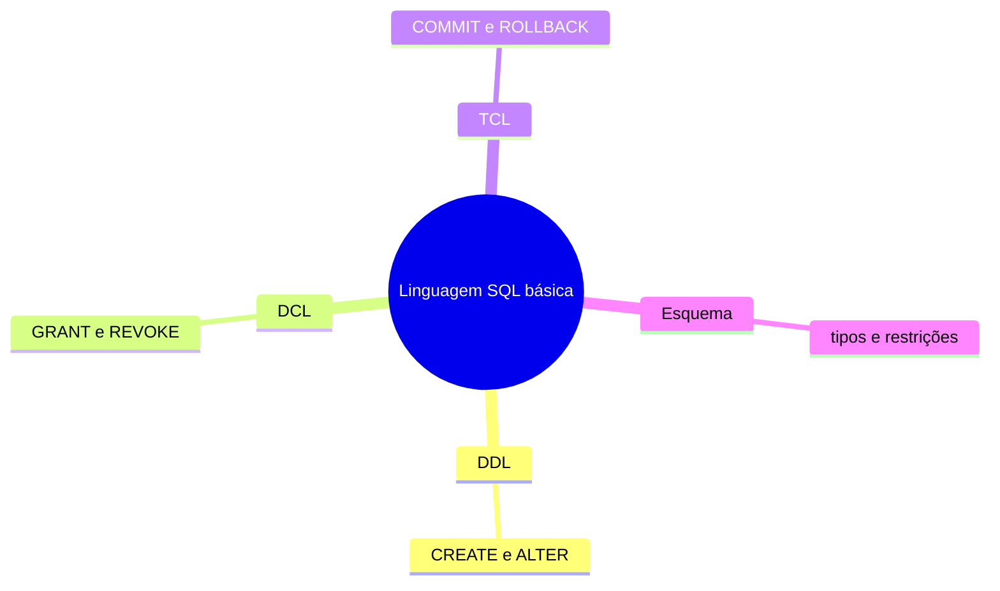

### Prática

1. Crie a tabela rascunho_produto com PK inteira, nome obrigatório e preço decimal não negativo.
2. Adicione uma coluna fornecedor de 25 caracteres e confirme sua existência.
3. Em uma conta de laboratório com privilégios administrativos, conceda e revogue SELECT sobre produto para um usuário de teste já criado.

## 7. Linguagem SQL — noções básicas

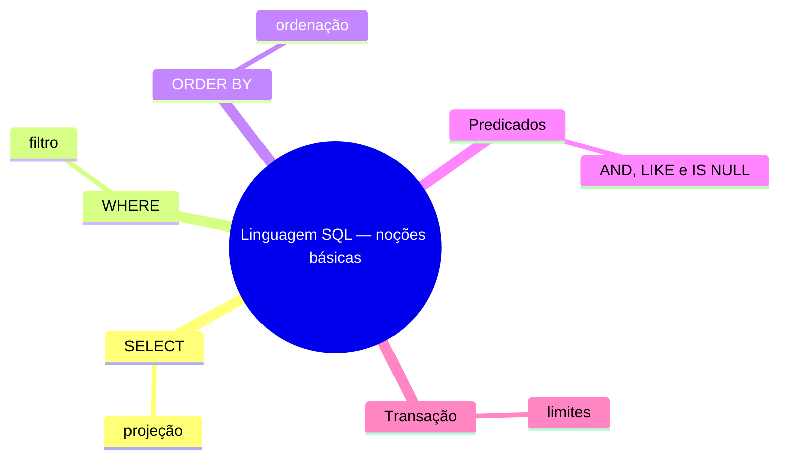

### Prática

1. Liste nomes de produtos com preço de pelo menos 50, do mais caro ao mais barato.
2. Encontre clientes sem e-mail com IS NULL. Compare com email = NULL.
3. Altere o estoque do produto 1 em uma transação, consulte o valor e desfaça a alteração.

## 8. DDL

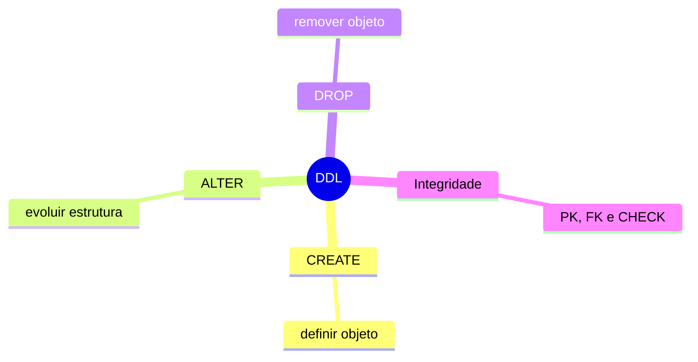

### Prática

1. Crie uma tabela categoria com nome único e acrescente uma FK opcional em produto.
2. Inspecione a definição com SHOW CREATE TABLE e confirme a FK.
3. Em tabela descartável, compare DELETE FROM e DROP TABLE. Observe a existência da tabela após cada operação.

## 9. DML

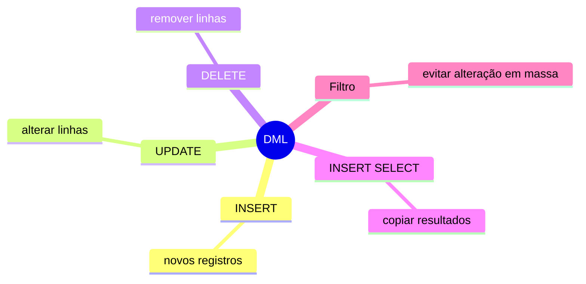

### Prática

1. Insira um cliente ativo de teste informando as colunas explicitamente.
2. Atualize o estoque do produto 2 para 18 e apague apenas o cliente que você inseriu.
3. Crie uma tabela de arquivo com id e nome e copie para ela apenas clientes inativos com INSERT SELECT.

## 10. SQL com junção

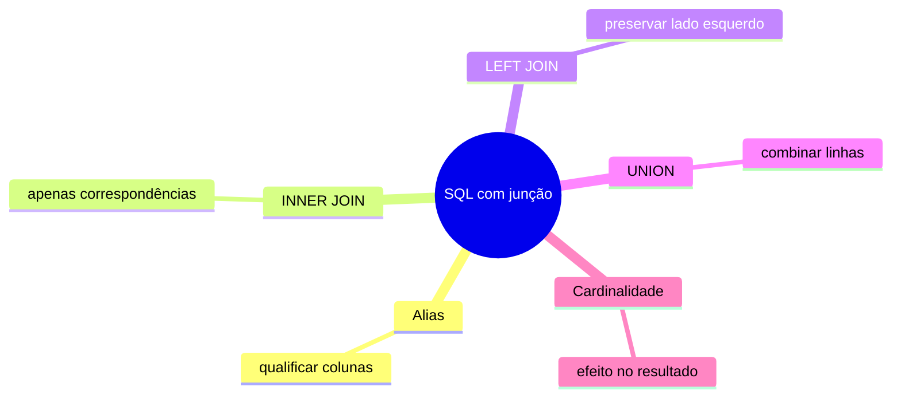

### Prática

1. Liste cada pedido com o nome de seu cliente usando INNER JOIN.
2. Liste clientes sem pedidos usando LEFT JOIN e teste de NULL sobre a PK do pedido.
3. Combine nomes de clientes e produtos em uma coluna com UNION. Compare com UNION ALL após criar um nome repetido em tabela descartável.

## 11. Consultas complexas

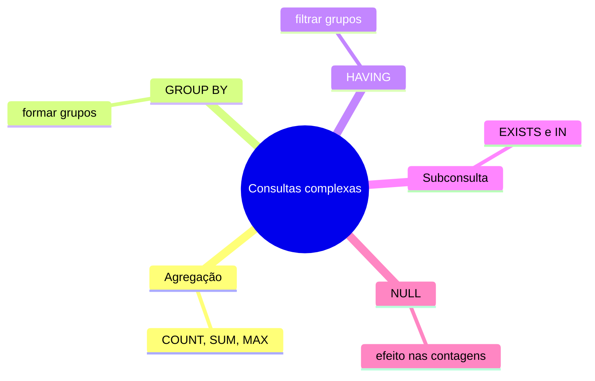

### Prática

1. Calcule a receita de cada pedido usando quantidade vezes preço praticado.
2. Mostre os clientes com dois ou mais pedidos usando GROUP BY e HAVING.
3. Use EXISTS para listar clientes que compraram o produto 1. Compare COUNT(*) e COUNT(email) em cliente.

## 12. Procedimentos, funções e gatilhos

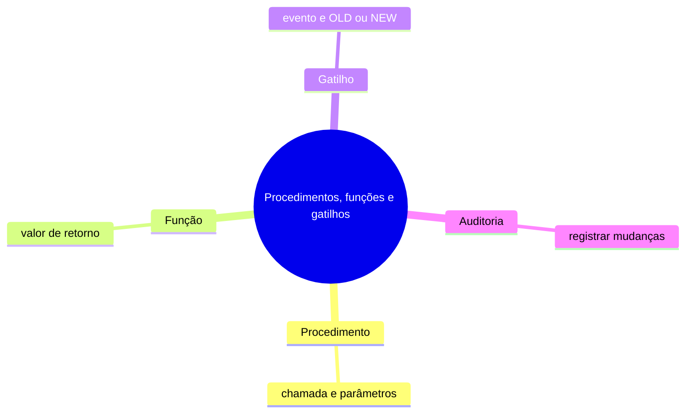

### Prática

1. Crie o procedimento atualizar_status com parâmetros de ID e novo status. Teste com o pedido 101.
2. Crie uma função escalar que calcule quantidade × preço para um item. Teste com 2 e 60.
3. Crie uma tabela de auditoria e um gatilho AFTER UPDATE em produto. Registre mudanças de estoque e confirme que uma mudança apenas de nome não gera registro.

## Gabarito e critérios de conferência

### 1. Conceitos de banco de dados

1. Workbench é o cliente, MySQL Server é o SGBD e study_sql é o esquema.
2. SELECT nome, email FROM cliente WHERE ativo = 1 retorna Ana, Bruno e Carla.
3. Considere transações, restrições e isolamento entre operações concorrentes.

### 2. Evolução dos bancos de dados

1. Um documento por produto permite atributos diferentes. O relacional também pode representar variação, por exemplo com JSON ou tabelas relacionadas.
2. Explique por que as transações e restrições importam para pedidos. Avalie o padrão de consultas antes de escolher documentos para o catálogo.
3. Ao final os estoques continuam 20 e 15. Associe o tudo ou nada à atomicidade.

### 3. Modelo relacional

1. CHAR(11), CHAR(2), DATE e DECIMAL(10,2).
2. A FK de pedido.cliente_id impede referência a cliente inexistente.
3. A PK é o par pedido_id e produto_id. A unicidade se aplica ao par.

### 4. Diagrama entidade-relacionamento

1. Entidades em retângulos, relacionamentos em losangos e atributos em elipses.
2. Cliente tem zero ou muitos pedidos. Cada pedido pertence a um cliente. Declare separadamente a regra sobre pedido vazio.
3. item_pedido representa o N:N e guarda quantidade e preço praticado.

### 5. Normalização de dados

1. Use Cliente e TelefoneCliente com uma linha por telefone.
2. Separe Pedido, Cliente, Produto e ItemPedido. Valide as dependências de cada tabela e a reconstrução com junções.
3. Separe FornecedorContato e FornecedorCategoria. Na FNBC, cada determinante de dependência funcional não trivial é superchave.

### 6. Linguagem SQL básica

1. Use CREATE TABLE com PRIMARY KEY, NOT NULL e CHECK (preco >= 0).
2. ALTER TABLE rascunho_produto ADD COLUMN fornecedor VARCHAR(25). Confira com DESCRIBE.
3. GRANT SELECT ON study_sql.produto TO 'leitor_teste'@'localhost' e REVOKE SELECT ON study_sql.produto FROM 'leitor_teste'@'localhost'.

### 7. Linguagem SQL — noções básicas

1. Esperado: Teclado e Mouse, nessa ordem.
2. IS NULL encontra Dora. A comparação com = NULL resulta em desconhecido.
3. START TRANSACTION, UPDATE com WHERE, SELECT e ROLLBACK. Estoque original: 20.

### 8. DDL

1. Use CREATE TABLE categoria e ALTER TABLE produto ADD COLUMN categoria_id INT, ADD FOREIGN KEY (categoria_id) REFERENCES categoria(id).
2. A definição deve mostrar a FK e a coluna referenciada.
3. DELETE preserva a estrutura. DROP remove a tabela e pode falhar se houver referências.

### 9. DML

1. Use INSERT INTO cliente (id,nome,email,ativo) VALUES (50,'Eva',NULL,1).
2. Use WHERE id = 2 para produto e WHERE id = 50 para cliente.
3. O arquivo recebe apenas Dora na base inicial.

### 10. SQL com junção

1. Três pedidos. Ana tem dois e Bruno tem um.
2. Carla e Dora.
3. UNION elimina duplicatas entre linhas. UNION ALL conserva todas.

### 11. Consultas complexas

1. Pedidos 101, 102 e 103 somam 180, 120 e 50, respectivamente.
2. Apenas Ana, com dois pedidos.
3. Apenas Ana. As contagens iniciais são 4 e 3.

### 12. Procedimentos, funções e gatilhos

1. Use UPDATE pedido SET status = p_status WHERE id = p_id e teste com CALL.
2. Declare a função DETERMINISTIC e retorne DECIMAL. Resultado esperado: 120,00.
3. Use IF OLD.estoque <> NEW.estoque THEN INSERT ... END IF, gravando ID, valor anterior, novo e timestamp.
